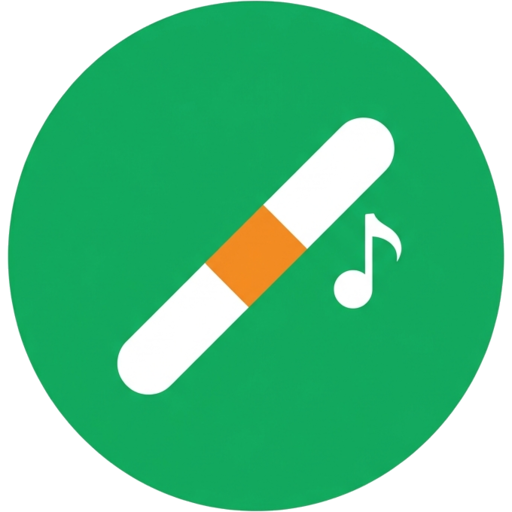
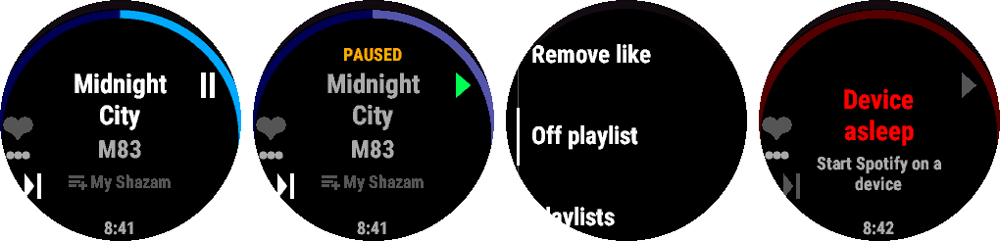
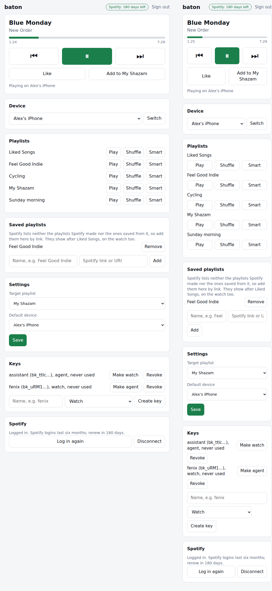

<p align="center">
  
</p>

<table>
<tr>
<td width="100">

</td>
<td>
<h1>baton</h1>
A self-hosted Spotify remote for Garmin watches, built to be used without looking.
</td>
</tr>
</table>

[](https://github.com/frederikb96/baton/actions/workflows/server.yml)
[](https://github.com/frederikb96/baton/actions/workflows/watch.yml)
[](https://opensource.org/licenses/MIT)

Gloves on, watch on the handlebar, phone in the pocket. One press likes the song, a double press puts it into a playlist, and the watch buzzes to tell you what happened. You never have to look at the screen.

<p align="center">
  
</p>

## Why

Garmin watches already control the music on your phone, and for play, pause and skip that is enough. Baton is for what the built-in controls don't do:

- **Like and playlist add that never toggle.** A press that finds the song already liked answers `already` with its own vibration instead of un-liking it. You can mash the button on a bumpy road and the result is always the one you meant. Removing a like is a separate menu entry.
- **A target playlist.** Double press adds the song to one playlist you picked, for example the one you collect songs to check out later in. Songs already in it are not added twice.
- **Start a playlist.** The menu lists the playlists you played last and starts one normally, shuffled or with smart shuffle (plain shuffle where Spotify doesn't offer it).
- **A web page for everything else.** The same server serves a small page for playback, the device, settings and watch keys.

## How it fits together

```
watch app  →  phone (Garmin Connect)  →  your baton server  →  Spotify Web API
```

The watch app only talks to your own server, over HTTPS through the phone's Garmin Connect app. The server holds the Spotify login, does the work and answers with a result and the current state in one small response. No Spotify credentials ever sit on the watch.

## What you need

- A Garmin watch from the supported list in [docs/watch.md](docs/watch.md): fēnix 8 family, epix 2 Pro 47 mm, Forerunner 265 and 965.
- A Spotify Premium account and **your own Spotify developer app**. Spotify limits apps of this kind to development mode, which means at most five Spotify accounts per app, each added by hand in the dashboard. One hosted instance can't serve many people, so everyone runs their own copy. [docs/server.md](docs/server.md) walks through the app setup.
- A place to run one container, reachable under an HTTPS address. The server speaks plain HTTP, so a reverse proxy or tunnel in front is part of the install.
- The [Connect IQ SDK](https://developer.garmin.com/connect-iq/sdk/) and a developer key to build the watch app yourself.

## Run your own

Server:

```sh
cp server/compose.example.yaml compose.yaml
# .env next to it: the BATON_* values from docs/server.md
docker compose up -d
```

Open the public URL, sign in, press *Log in with Spotify*, create a watch key and keep it for the next step. Details, the full variable list and the two authentication modes are in [docs/server.md](docs/server.md).

Watch:

```sh
cd watch
BATON_URL=https://baton.example.com BATON_WATCH_KEY=<key> ./configure
monkeyc -f monkey.jungle -d fenix8solar47mm -o bin/baton.prg -y developer_key.der -w
```

Copy `bin/baton.prg` to `GARMIN/Apps` on the watch over USB. Build options, the device log and the simulator setup are in [docs/watch.md](docs/watch.md).

## Controls

| Button | Press | Action |
|---|---|---|
| Start | short | play / pause |
| Down | short / double | next / previous track |
| Up | short | add to Liked Songs |
| Up | double | add to the target playlist |
| Up | hold | menu: remove like, remove from playlist, start a playlist |
| Back | short | exit |

The vibration patterns, the screen and how the app is launched are described in [docs/watch.md](docs/watch.md).

## The web page

<p align="center">
  
</p>

The page shows the same state as the watch, switches the playback device, starts recent playlists, sets the target playlist and the default device, creates and revokes keys (watch keys for the watch, agent keys that also reach the Spotify Web API through the server) and shows how many days the Spotify login has left. The device lists follow Spotify while the page is open, so a phone appears once its Spotify app is running. Spotify logins last six months and can't be extended, so you log in again from here now and then.

## Docs

- [docs/server.md](docs/server.md): running the server, the Spotify developer app, configuration, authentication
- [docs/api.md](docs/api.md): the HTTP contract between watch and server
- [docs/watch.md](docs/watch.md): controls, vibration patterns, build, install, development

## Prior art

Baton shares no code with the projects below, but they were there first and are worth a look:

- [NielsOpdam78/GarminEdge-Spotify](https://github.com/NielsOpdam78/GarminEdge-Spotify) (MIT): a Connect IQ data field for touchscreen Edge computers that talks to the Web API directly. Its README is also a good explanation of Spotify's development-mode limits.
- [bobok7/SpotiRide](https://github.com/bobok7/SpotiRide) (MIT): a Spotify remote for the Edge 530 with a like button.
- [csaavedrae/garmin-spotify-project](https://github.com/csaavedrae/garmin-spotify-project) (MIT): a watch app with an Android companion app on top of Spotify's App Remote SDK.

Others that did similar things earlier: [ekallevig/garmin-spotify-widget](https://github.com/ekallevig/garmin-spotify-widget) and [krakentom/GarminSpotifyRemoteController](https://github.com/krakentom/GarminSpotifyRemoteController).

## License

[MIT](LICENSE)
